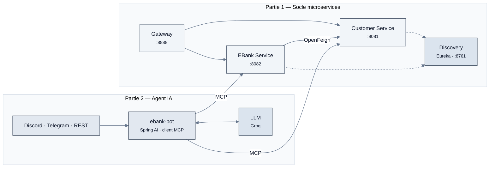

<div align="center">

# E-Bank — Architecture Microservices & Agent IA

**Système bancaire distribué avec Spring Boot, Spring Cloud et Spring AI**

*Module : Systèmes Distribués & DevOps — S5*


</div>

---

## Présentation

**E-Bank** est un projet académique qui construit, étape par étape, un système bancaire fondé sur une **architecture microservices**. Il commence par le socle distribué : services métier, découverte, passerelle et tolérance aux pannes. Il y ajoute ensuite un **assistant conversationnel intelligent** capable d'interroger ces services.

Chaque partie du projet est livrée sur **sa propre branche Git**, avec un rapport dédié dans son `README`.

## Parties du projet

| Partie | Contenu | Branche | Rapport |
|:-:|---|---|---|
| **1** | Customer-Service, EBank-Service, OpenFeign, Circuit Breaker Resilience4J, Gateway, Discovery Service (Eureka), tests Postman et Swagger-UI | [`partie-1`](https://github.com/charly-zoungrana/ebank-microservices-project/tree/partie-1) | [Lire le rapport →](https://github.com/charly-zoungrana/ebank-microservices-project/blob/partie-1/README.md) |
| **2** | Agent IA avec Spring AI, LLM via Groq, mémoire de conversation, serveurs et client **MCP**, bots **Discord** et **Telegram** | [`partie-2`](https://github.com/charly-zoungrana/ebank-microservices-project/tree/partie-2) | [Lire le rapport →](https://github.com/charly-zoungrana/ebank-microservices-project/blob/partie-2/README.md) |

## Vue d'ensemble



## Stack technique

| Domaine | Technologies |
|---|---|
| Socle | Java 21 · Spring Boot 4.1.1 · Maven |
| Microservices | Spring Data JPA · H2 · Spring Cloud Gateway · Eureka · OpenFeign · Resilience4J |
| Intelligence artificielle | Spring AI 2.0.1 · Groq (`gpt-oss-120b`) · Model Context Protocol |
| Canaux | Discord (JDA) · Telegram Bots API |
| Documentation et tests | springdoc-openapi (Swagger-UI) · Postman · PlantUML · Mermaid |

## Naviguer entre les parties

```bash
git clone https://github.com/charly-zoungrana/ebank-microservices-project.git
cd ebank-microservices-project

git switch partie-1   # socle microservices
git switch partie-2   # agent IA + MCP
```

> Après chaque changement de branche, rechargez les projets Maven et reconstruisez le projet avant de relancer les services.

---

<div align="center"><sub>ZOUNGRANA Charly · Projet réalisé dans le cadre du module Systèmes Distribués & DevOps</sub></div>
