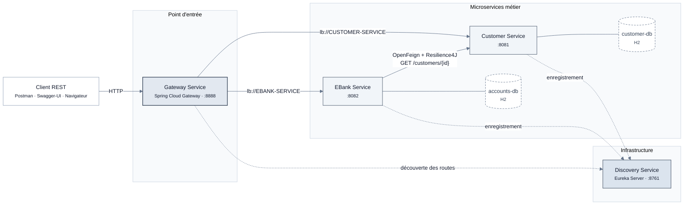
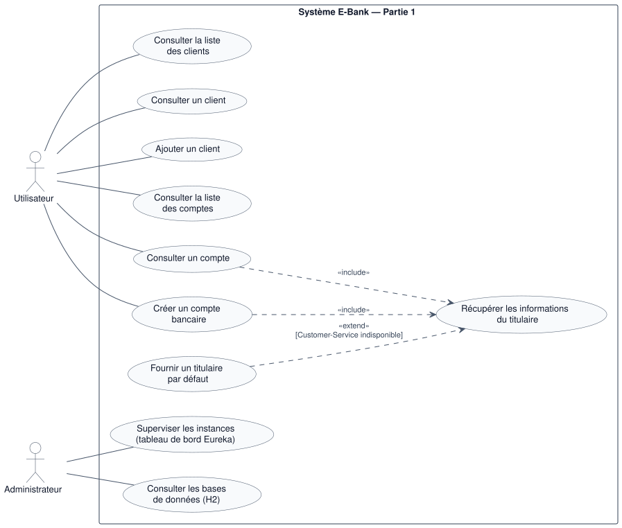
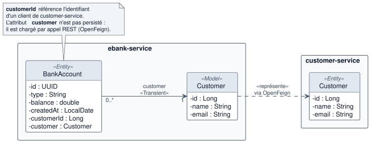
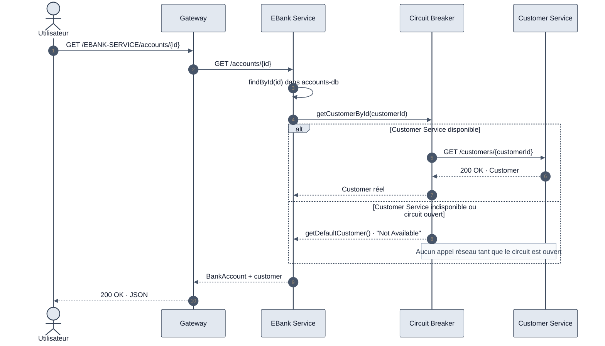

<div align="center">

# E-Bank — Architecture Microservices

**Système bancaire distribué avec Spring Boot & Spring Cloud**

*Module : Systèmes Distribués & DevOps — S5*


</div>

---

## Sommaire

- [Partie 1 — Microservices, communication et tolérance aux pannes](#partie-1--microservices-communication-et-tolérance-aux-pannes)
  - [1.1 Objectifs](#11-objectifs)
  - [1.2 Stack technique](#12-stack-technique)
  - [1.3 Architecture technique](#13-architecture-technique)
  - [1.4 Diagramme de cas d'utilisation](#14-diagramme-de-cas-dutilisation)
  - [1.5 Diagramme de classes](#15-diagramme-de-classes)
  - [1.6 Description des microservices](#16-description-des-microservices)
  - [1.7 Communication inter-services et tolérance aux pannes](#17-communication-inter-services-et-tolérance-aux-pannes)
  - [1.8 API REST exposées](#18-api-rest-exposées)
  - [1.9 Démarrage et tests](#19-démarrage-et-tests)
  - [1.10 Structure du projet](#110-structure-du-projet)
  - [1.11 Bilan](#111-bilan)

---

## Partie 1 — Microservices, communication et tolérance aux pannes

> Référence : [vidéo de la partie 1](https://www.youtube.com/watch?v=cdFz3VemT1Q)

### 1.1 Objectifs

| # | Objectif | Statut |
|:-:|---|:-:|
| 1 | Développer le microservice **Customer-Service** (gestion des clients) | ✔ |
| 2 | Développer le microservice **EBank-Service** (gestion des comptes bancaires) | ✔ |
| 3 | Faire communiquer les deux services avec **OpenFeign** | ✔ |
| 4 | Assurer la tolérance aux pannes avec un **Circuit Breaker Resilience4J** | ✔ |
| 5 | Développer la **Gateway** (point d'entrée unique) | ✔ |
| 6 | Développer le **Discovery Service** (annuaire Eureka) | ✔ |
| 7 | Tester les services backend avec **Postman** et **Swagger-UI** | ✔ |

### 1.2 Stack technique

| Couche | Technologie | Rôle |
|---|---|---|
| Langage | Java 21 | — |
| Framework | Spring Boot 4.1.1 | Socle des microservices |
| Persistance | Spring Data JPA · H2 (en mémoire) | Une base de données par service |
| Service discovery | Spring Cloud Netflix Eureka | Enregistrement et découverte des services |
| API Gateway | Spring Cloud Gateway (WebFlux) | Routage dynamique des requêtes |
| Communication | Spring Cloud OpenFeign | Client REST déclaratif entre services |
| Résilience | Spring Cloud Circuit Breaker · Resilience4J | Tolérance aux pannes, fallback |
| Documentation API | springdoc-openapi (Swagger-UI) | Documentation et test interactif |
| Outillage | Lombok · Maven · Postman | — |

### 1.3 Architecture technique



**Principes appliqués :**

- **Un service, une base.** Chaque microservice possède sa propre base H2. EBank-Service ne lit jamais directement la table des clients : il passe par l'API de Customer-Service.
- **Découverte dynamique.** Les services s'enregistrent auprès d'Eureka sous leur nom logique (`CUSTOMER-SERVICE`, `EBANK-SERVICE`). Aucune adresse n'est codée en dur entre services.
- **Point d'entrée unique.** Les clients externes passent par la Gateway, qui construit ses routes automatiquement à partir du registre Eureka et répartit la charge (`lb://`).
- **Résilience.** L'appel inter-services est protégé par un circuit breaker. Une panne de Customer-Service ne fait pas tomber EBank-Service.

### 1.4 Diagramme de cas d'utilisation

<p align="center">
  
</p>

| Acteur | Description |
|---|---|
| **Utilisateur** | Consommateur de l'API (Postman, Swagger-UI, front-end). Il accède aux services via la Gateway. |
| **Administrateur** | Supervise l'état des instances dans Eureka et inspecte les données dans les consoles H2. |

**Relations entre cas d'utilisation :**

- **«include»** : consulter ou créer un compte **inclut systématiquement** la récupération des informations du titulaire auprès de Customer-Service (appel OpenFeign).
- **«extend»** : *Fournir un titulaire par défaut* **étend** la récupération du titulaire, **uniquement** quand Customer-Service est indisponible (fallback du Circuit Breaker). Comme le veut la notation UML, la flèche part du cas qui étend et pointe vers le cas de base.

### 1.5 Diagramme de classes

<p align="center">
  
</p>

Le diagramme présente les **entités** et le **modèle** de chaque microservice. Chaque service est encadré dans son propre paquetage, ce qui fait ressortir que les deux services ne partagent ni code ni base de données.

**Points de conception :**

- **Pas de relation JPA entre services.** `BankAccount` ne stocke que l'identifiant du client (`customerId`). L'attribut `customer` est annoté `@Transient` : il n'est pas persisté, mais complété à la volée par un appel OpenFeign.
- **Modèle local du client.** EBank-Service définit sa propre classe `Customer` (package `model`, stéréotype «Model»), sans annotation JPA. Elle sert uniquement à recevoir la réponse de Customer-Service, ce qui évite de partager du code entre microservices.
- **Identifiants.** `Customer` utilise un `Long` auto-incrémenté (`IDENTITY`) et `BankAccount` un `UUID` généré (`GenerationType.UUID`).

> Les sources PlantUML des diagrammes se trouvent dans [`docs/diagrams/`](docs/diagrams/).

### 1.6 Description des microservices

| Service | Port | Nom Eureka | Responsabilité | Dépendances clés |
|---|:-:|---|---|---|
| **discovery-service** | `8761` | — | Annuaire des services (Eureka Server) | `eureka-server` |
| **customer-service** | `8081` | `CUSTOMER-SERVICE` | Gestion des clients | `data-jpa`, `h2`, `eureka-client`, `springdoc` |
| **ebank-service** | `8082` | `EBANK-SERVICE` | Gestion des comptes bancaires | `data-jpa`, `h2`, `eureka-client`, `openfeign`, `resilience4j`, `springdoc` |
| **gateway-service** | `8888` | `GATEWAY-SERVICE` | Point d'entrée et routage | `gateway-server-webflux`, `eureka-client` |

#### Discovery Service

Serveur Eureka activé par `@EnableEurekaServer`. Il ne s'enregistre pas lui-même et ne récupère aucun registre :

```properties
eureka.client.register-with-eureka=false
eureka.client.fetch-registry=false
```

#### Customer Service

Expose le CRUD des clients. Au démarrage, un `CommandLineRunner` initialise trois clients de test (`John`, `Jane`, `Rachid`).

#### EBank Service

Gère les comptes bancaires (`SAVINGS-ACCOUNT` ou `CURRENT-ACCOUNT`). Au démarrage, il génère cinq comptes par client avec un solde aléatoire. Avant chaque création de compte, il vérifie l'existence du client auprès de Customer-Service via OpenFeign.

#### Gateway Service

Le routage a d'abord été défini de façon **statique**, en YAML, avec des URI fixes. Il est maintenant **dynamique** : un bean `DiscoveryClientRouteDefinitionLocator`, déclaré dans `DynamicRoutesConfig`, génère automatiquement une route pour chaque service enregistré dans Eureka. L'URL d'accès prend la forme :

```
http://localhost:8888/{NOM-DU-SERVICE}/{chemin}
```

### 1.7 Communication inter-services et tolérance aux pannes

EBank-Service appelle Customer-Service par l'interface déclarative `CustomerRestClient`. OpenFeign résout le nom logique `customer-service` grâce à Eureka et répartit les appels entre les instances.

```java
@FeignClient(name = "customer-service")
public interface CustomerRestClient {

    @GetMapping("/customers/{id}")
    @CircuitBreaker(name = "customerService", fallbackMethod = "getDefaultCustomer")
    Customer getCustomerById(@PathVariable Long id);

    default Customer getDefaultCustomer(Long id, Exception e) {
        return Customer.builder()
                .id(id).name("Not Available").email("Not Available")
                .build();
    }
}
```

Le circuit breaker **Resilience4J** surveille les appels. Si Customer-Service est indisponible ou en erreur, la méthode de repli renvoie un client par défaut. EBank-Service continue alors de répondre au lieu de propager la panne.



### 1.8 API REST exposées

**Customer Service** (`/customers`)

| Méthode | Endpoint | Description |
|:-:|---|---|
| `GET` | `/customers` | Liste de tous les clients |
| `GET` | `/customers/{id}` | Détail d'un client |
| `POST` | `/customers` | Création d'un client |

**EBank Service** (`/accounts`)

| Méthode | Endpoint | Description |
|:-:|---|---|
| `GET` | `/accounts` | Liste de tous les comptes |
| `GET` | `/accounts/{id}` | Détail d'un compte, enrichi des informations du titulaire |
| `POST` | `/accounts` | Création d'un compte (vérification du client via OpenFeign) |

**Accès via la Gateway**

| Ressource | URL |
|---|---|
| Clients | `http://localhost:8888/CUSTOMER-SERVICE/customers` |
| Comptes | `http://localhost:8888/EBANK-SERVICE/accounts` |

### 1.9 Démarrage et tests

#### Prérequis

- JDK 21
- Maven 3.9+ (ou le wrapper `mvnw` fourni)

#### Ordre de démarrage

L'ordre compte : chaque service doit pouvoir s'enregistrer auprès d'Eureka au démarrage.

```bash
# 1. Annuaire
cd discovery-service && ../mvnw spring-boot:run

# 2. Services métier
cd customer-service  && ../mvnw spring-boot:run
cd ebank-service     && ../mvnw spring-boot:run

# 3. Point d'entrée
cd gateway-service   && ../mvnw spring-boot:run
```

#### Outils de test et de supervision

| Outil | URL |
|---|---|
| Tableau de bord Eureka | http://localhost:8761 |
| Swagger-UI — Customer Service | http://localhost:8081/swagger-ui.html |
| Swagger-UI — EBank Service | http://localhost:8082/swagger-ui.html |
| Console H2 — Customer Service | http://localhost:8081/h2-console (`jdbc:h2:mem:customer-db`) |
| Console H2 — EBank Service | http://localhost:8082/h2-console (`jdbc:h2:mem:accounts-db`) |

#### Scénarios de test réalisés

| # | Scénario | Résultat attendu |
|:-:|---|---|
| 1 | Ouvrir le tableau de bord Eureka | `CUSTOMER-SERVICE`, `EBANK-SERVICE` et `GATEWAY-SERVICE` apparaissent avec le statut `UP` |
| 2 | `GET /customers` via la Gateway | Les trois clients initialisés sont retournés |
| 3 | `GET /accounts/{id}` via la Gateway | Le compte est retourné avec l'objet `customer` complété par OpenFeign |
| 4 | Arrêter Customer-Service puis rejouer le scénario 3 | Le compte est retourné avec un client `"Not Available"` : le fallback du circuit breaker fonctionne |
| 5 | Tester les endpoints dans Swagger-UI et Postman | Réponses `200 OK` conformes à la documentation OpenAPI |

### 1.10 Structure du projet

```
e-bank-ms-project/
├── discovery-service/          # Eureka Server
├── gateway-service/            # Spring Cloud Gateway
│   └── config/DynamicRoutesConfig.java
├── customer-service/
│   ├── entities/Customer.java
│   ├── repository/CustomerRepository.java
│   ├── service/CustomerService.java
│   └── web/CustomerRestController.java
└── ebank-service/
    ├── entities/BankAccount.java
    ├── model/Customer.java
    ├── feign/CustomerRestClient.java
    ├── repository/BankAccountRepository.java
    ├── services/EBankService.java
    └── web/EBankRestController.java
```

### 1.11 Bilan

Cette première partie met en place le socle d'une architecture microservices complète :

- **Découplage** : deux services métier autonomes, chacun avec ses données, qui communiquent uniquement par API REST.
- **Localisation transparente** : grâce à Eureka, ni la Gateway ni OpenFeign ne dépendent d'adresses fixes.
- **Point d'entrée unique** : la Gateway centralise l'accès et route dynamiquement selon le registre.
- **Résilience** : le circuit breaker Resilience4J isole les pannes et garantit une réponse dégradée plutôt qu'une erreur en cascade.

Ce socle sert de base aux parties suivantes du projet.

---

<div align="center"><sub>Projet réalisé dans le cadre du module Systèmes Distribués & DevOps</sub></div>
