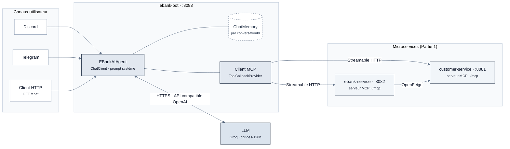
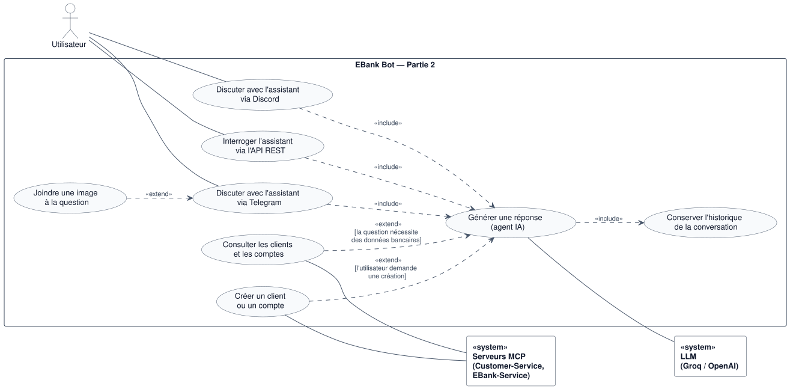
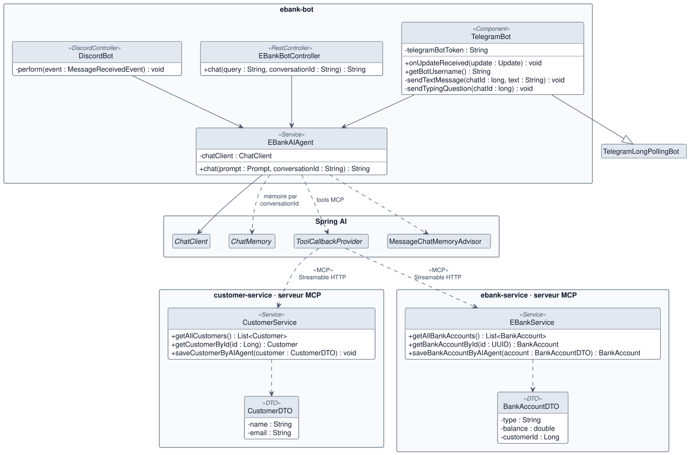
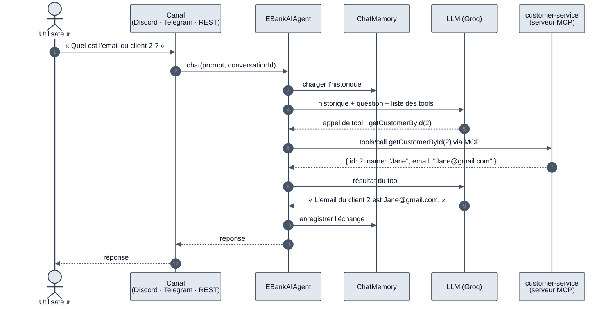

<div align="center">

# E-Bank — Partie 2

**Agent IA bancaire avec Spring AI et Model Context Protocol (MCP)**

*Module : Systèmes Distribués & DevOps — S5*


[← Retour au sommaire du projet](https://github.com/charly-zoungrana/ebank-microservices-project) · [Partie 1](https://github.com/charly-zoungrana/ebank-microservices-project/tree/partie-1)

</div>

---

## Sommaire

- [Partie 2 — Agent IA, MCP et canaux de discussion](#partie-2--agent-ia-mcp-et-canaux-de-discussion)
  - [2.1 Objectifs](#21-objectifs)
  - [2.2 Stack technique](#22-stack-technique)
  - [2.3 Architecture technique](#23-architecture-technique)
  - [2.4 Diagramme de cas d'utilisation](#24-diagramme-de-cas-dutilisation)
  - [2.5 Diagramme de classes](#25-diagramme-de-classes)
  - [2.6 Le Model Context Protocol (MCP)](#26-le-model-context-protocol-mcp)
  - [2.7 L'agent IA EBankAIAgent](#27-lagent-ia-ebankaiagent)
  - [2.8 Canaux de discussion](#28-canaux-de-discussion)
  - [2.9 Configuration et gestion des secrets](#29-configuration-et-gestion-des-secrets)
  - [2.10 Démarrage et tests](#210-démarrage-et-tests)
  - [2.11 Difficultés rencontrées et solutions](#211-difficultés-rencontrées-et-solutions)
  - [2.12 Bilan](#212-bilan)

---

## Partie 2 — Agent IA, MCP et canaux de discussion

Cette partie s'appuie sur l'architecture microservices de la [Partie 1](https://github.com/charly-zoungrana/ebank-microservices-project/tree/partie-1). Elle ajoute un **assistant bancaire conversationnel** capable de consulter et de créer des clients et des comptes. Pour cela, il appelle les microservices existants au moyen du **Model Context Protocol**.

### 2.1 Objectifs

| # | Objectif | Statut |
|:-:|---|:-:|
| 1 | Créer le microservice **ebank-bot**, branché sur un LLM via Spring AI | ✔ |
| 2 | Utiliser un LLM **gratuit** grâce à l'API compatible OpenAI de **Groq** | ✔ |
| 3 | Doter l'agent d'une **mémoire de conversation** | ✔ |
| 4 | Transformer **Customer-Service** et **EBank-Service** en **serveurs MCP** | ✔ |
| 5 | Permettre à l'agent d'**appeler les tools MCP** pour accéder aux données bancaires | ✔ |
| 6 | Exposer l'agent sur **Discord** | ✔ |
| 7 | Exposer l'agent sur **Telegram** | ✔ |

### 2.2 Stack technique

| Couche | Technologie | Rôle |
|---|---|---|
| Framework IA | Spring AI 2.0.1 | `ChatClient`, advisors, mémoire, tool calling |
| Modèle de langage | `openai/gpt-oss-120b` via Groq | Génération des réponses (API compatible OpenAI) |
| Protocole d'outils | Model Context Protocol, transport **Streamable HTTP** | Exposition des opérations métier sous forme de tools |
| Serveurs MCP | `spring-ai-starter-mcp-server-webmvc` | Dans customer-service et ebank-service |
| Client MCP | `spring-ai-starter-mcp-client` | Dans ebank-bot |
| Discord | `spring-boot-starter-discord` 5.0.4 (JDA 6) | Canal de discussion Discord |
| Telegram | `telegrambots-spring-boot-starter` 6.9.7.1 | Canal de discussion Telegram |
| Socle | Spring Boot 4.1.1 · Spring Cloud · Eureka | Hérité de la Partie 1 |

### 2.3 Architecture technique



**Principes :**

- **Un seul agent, plusieurs canaux.** Discord, Telegram et l'API REST délèguent tous au même service `EBankAIAgent`. La logique IA n'est écrite qu'une fois.
- **Les microservices restent maîtres de leurs données.** L'agent n'accède jamais aux bases H2. Il passe par les tools MCP exposés par chaque service, qui réutilisent la couche service existante.
- **Le LLM décide des outils à appeler.** Le modèle reçoit la liste des tools disponibles avec leurs descriptions. Il choisit lui-même lesquels appeler pour répondre à la question.

### 2.4 Diagramme de cas d'utilisation

<p align="center">
  
</p>

| Acteur | Type | Description |
|---|---|---|
| **Utilisateur** | Principal | Discute avec l'assistant depuis Discord, Telegram ou l'API REST. |
| **LLM (Groq / OpenAI)** | Système secondaire | Génère les réponses et décide des tools à appeler. |
| **Serveurs MCP** | Système secondaire | Customer-Service et EBank-Service exécutent les tools demandés par l'agent. |

**Relations :**

- **«include»** : quel que soit le canal, chaque message déclenche la génération d'une réponse par l'agent, qui inclut toujours la gestion de l'historique.
- **«extend»** : la consultation ou la création de données bancaires n'a lieu **que si** la question le nécessite. C'est le LLM qui décide d'appeler un tool. Joindre une image n'est possible que sur Telegram.

### 2.5 Diagramme de classes

<p align="center">
  
</p>

Les trois points d'entrée (`EBankBotController`, `DiscordBot`, `TelegramBot`) dépendent uniquement de `EBankAIAgent`. L'agent s'appuie sur les abstractions de Spring AI (`ChatClient`, `ChatMemory`, `ToolCallbackProvider`). Les tools sont fournis à distance par les services annotés `@McpTool` dans chaque microservice. Les DTO (`CustomerDTO`, `BankAccountDTO`) décrivent les données que l'agent doit fournir pour une création.

> Les sources PlantUML des diagrammes se trouvent dans [`docs/diagrams/`](docs/diagrams/).

### 2.6 Le Model Context Protocol (MCP)

Le **MCP** est un protocole ouvert qui standardise la façon dont une application d'IA se connecte à des outils et à des données externes. Un **serveur MCP** expose des *tools*, et un **client MCP** les découvre et les met à disposition du LLM. Les messages échangés suivent le format **JSON-RPC 2.0**.

#### Tools exposés

| Serveur MCP | Tool | Description |
|---|---|---|
| customer-service | `getAllCustomers` | Liste de tous les clients |
| customer-service | `getCustomerById(id)` | Détail d'un client |
| customer-service | `saveCustomerByAIAgent(customer)` | Création d'un client (`name`, `email`) |
| ebank-service | `getAllBankAccounts` | Liste de tous les comptes |
| ebank-service | `getBankAccountById(id)` | Détail d'un compte et de son titulaire |
| ebank-service | `saveBankAccountByAIAgent(account)` | Création d'un compte (`type`, `balance`, `customerId`) |

Chaque tool est une méthode de service annotée. La description sert au LLM pour comprendre quand l'utiliser :

```java
@McpTool(description = "Find Customer By id")
public Customer getCustomerById(@McpToolParam(description = "The id of the customer") Long id) {
    return customerRepository.findById(id)
            .orElseThrow(() -> new RuntimeException("Customer not found"));
}
```

#### Choix du transport

| Transport | Principe | Choix |
|---|---|:-:|
| stdio | Processus local, entrée et sortie standard | — |
| SSE | Deux endpoints, connexion permanente (déprécié) | — |
| **Streamable HTTP** | Un seul endpoint `/mcp`, streaming à la demande | ✔ |
| Stateless | Streamable HTTP sans session | — |

Le transport **Streamable HTTP** est le standard actuel de la spécification MCP. Il fonctionne à distance, ce qui est indispensable entre microservices, et n'utilise un flux SSE que lorsque c'est nécessaire.

```properties
# Serveurs (customer-service, ebank-service)
spring.ai.mcp.server.protocol=streamable

# Client (ebank-bot)
spring.ai.mcp.client.streamable-http.connections.customers.url=http://localhost:8081/mcp
spring.ai.mcp.client.streamable-http.connections.accounts.url=http://localhost:8082/mcp
```

### 2.7 L'agent IA EBankAIAgent

```java
@Service
public class EBankAIAgent {
    private final ChatClient chatClient;

    public EBankAIAgent(ChatClient.Builder chatClient, ChatMemory chatMemory, ToolCallbackProvider tools) {
        this.chatClient = chatClient
                .defaultSystem("""
                        Tu es un assistant chargé de répondre aux questions de l'utilisateur
                        à propos des clients et des comptes bancaires, en fonction du contexte fourni.
                        Si aucun contexte n'est fourni, réponds par JE NE SAIS PAS.
                        """)
                .defaultOptions(OpenAiChatOptions.builder()
                        .extraBody(Map.of("include_reasoning", false)))
                .defaultAdvisors(MessageChatMemoryAdvisor.builder(chatMemory).build())
                .defaultTools(tools)
                .build();
    }

    public String chat(Prompt prompt, String conversationId) {
        return chatClient.prompt(prompt)
                .advisors(a -> a.param(ChatMemory.CONVERSATION_ID, conversationId))
                .call()
                .content();
    }
}
```

| Élément | Rôle |
|---|---|
| `defaultSystem(...)` | Prompt système : cadre le rôle de l'assistant et limite les réponses inventées. |
| `MessageChatMemoryAdvisor` | Advisor qui ajoute l'historique avant chaque appel et enregistre l'échange après. |
| `CONVERSATION_ID` | Isole la mémoire de chaque utilisateur : identifiant Discord, `chatId` Telegram, ou paramètre HTTP. |
| `defaultTools(tools)` | Met les tools MCP des deux serveurs à disposition du LLM. |
| `extraBody(include_reasoning=false)` | Paramètre propre à Groq : n'expose pas le raisonnement interne de gpt-oss (voir [2.11](#211-difficultés-rencontrées-et-solutions)). |

#### Déroulement d'une question avec appel de tool



### 2.8 Canaux de discussion

| Canal | Classe | Identifiant de conversation | Particularités |
|---|---|---|---|
| API REST | `EBankBotController` | paramètre `conversationId` (défaut : `default`) | `GET /chat?query=...&conversationId=...`, réponse en `text/plain` |
| Discord | `DiscordBot` | identifiant de l'auteur du message | Ignore les messages des bots, répond dans le même salon |
| Telegram | `TelegramBot` | `chatId` | Long polling, indicateur « en train d'écrire », prise en charge des **images** jointes |

Sur Telegram, les photos reçues sont converties en objets `Media` et jointes au `UserMessage`. Leur interprétation dépend des capacités du modèle utilisé : il faut un modèle **multimodal**.

### 2.9 Configuration et gestion des secrets

Aucun secret n'est écrit dans le code ni dans `application.properties`. Ils sont lus depuis un fichier `.env` local, **ignoré par Git**.

```properties
# ebank-bot/src/main/resources/application.properties
spring.config.import=optional:file:.env[.properties]

spring.ai.openai.base-url=https://api.groq.com/openai/v1
spring.ai.openai.api-key=${GROQ_API_KEY}
spring.ai.openai.chat.options.model=openai/gpt-oss-120b

discord.token=${DISCORD_TOKEN}
telegram.token=${TELEGRAM_TOKEN}
```

```properties
# ebank-bot/.env  (non versionné)
GROQ_API_KEY=...
DISCORD_TOKEN=...
TELEGRAM_TOKEN=...
```

> Le *working directory* de la configuration de lancement doit être le dossier `ebank-bot`, pour que le chemin relatif `.env` soit résolu.

**Changer de fournisseur LLM.** Le starter OpenAI de Spring AI fonctionne avec toute API compatible OpenAI. Pour revenir sur OpenAI, il suffit de retirer la `base-url`, de changer la clé et le nom du modèle, et de supprimer le paramètre `include_reasoning`, propre à Groq.

### 2.10 Démarrage et tests

#### Ordre de démarrage

Le client MCP se connecte aux serveurs **au démarrage** du bot. Les services doivent donc être lancés avant lui.

| Ordre | Service | Port |
|:-:|---|:-:|
| 1 | discovery-service | 8761 |
| 2 | customer-service (serveur MCP) | 8081 |
| 3 | ebank-service (serveur MCP) | 8082 |
| 4 | gateway-service | 8888 |
| 5 | **ebank-bot** | 8083 |

Dans les logs du bot, chaque connexion MCP réussie affiche une ligne `Server response with Protocol: ...`.

#### Scénarios de test

| # | Canal | Message | Comportement attendu |
|:-:|---|---|---|
| 1 | REST | `/chat?query=Bonjour` | Réponse de politesse, aucun tool appelé |
| 2 | REST | `/chat?query=Liste les clients` | Appel de `getAllCustomers`, liste des trois clients |
| 3 | REST | « Je m'appelle Charly » puis « Comment je m'appelle ? » (même `conversationId`) | L'agent se souvient du prénom |
| 4 | REST | Même question avec un autre `conversationId` | L'agent ne connaît pas le prénom : les mémoires sont isolées |
| 5 | Discord | « Quels sont les comptes du client 1 ? » | Appel des tools d'ebank-service, réponse dans le salon |
| 6 | Telegram | « Crée un client Alice, alice@mail.com » | Appel de `saveCustomerByAIAgent`, client visible ensuite via `GET /customers` |

### 2.11 Difficultés rencontrées et solutions

| Problème | Cause | Solution |
|---|---|---|
| `404 Unknown request URL /openai/chat/completions` | Spring AI 2 utilise le SDK Java d'OpenAI, qui n'ajoute pas `/v1` | `base-url=https://api.groq.com/openai/v1` |
| `conversationId cannot be null` | Spring AI 2 n'a plus d'identifiant de conversation par défaut | Passage explicite de `ChatMemory.CONVERSATION_ID` à chaque requête |
| `property 'reasoning_content' is unsupported` au 2ᵉ message | Le raisonnement de gpt-oss est stocké en mémoire, puis renvoyé à Groq, qui le refuse | `extraBody(Map.of("include_reasoning", false))` |
| `ClassCastException` sur `defaultOptions` | En Spring AI 2, `defaultOptions` attend un **builder** et non des options construites | Passer `OpenAiChatOptions.builder()...` sans `.build()` |
| `defaultToolCallbacks` déprécié | API unifiée en Spring AI 2 | `defaultTools(tools)` |
| `Client failed to initialize` (MCP, 404 sur `/mcp`) | Starter `mcp-server` sans web (stdio uniquement), ou service lancé avec un ancien build | Starter `spring-ai-starter-mcp-server-webmvc`, puis rebuild et redémarrage |
| Push GitHub refusé (*secret detected*) | Token Discord en clair dans un commit intermédiaire | Fusion des commits (`git reset --soft`) et secrets en variables d'environnement |

### 2.12 Bilan

Cette deuxième partie transforme le système E-Bank en plateforme **pilotable en langage naturel** :

- **Interopérabilité.** Grâce à MCP, les microservices exposent leurs opérations sous une forme standard, utilisable par n'importe quel client compatible, et pas seulement par ce bot.
- **Réutilisation.** Les tools s'appuient sur la couche service de la Partie 1. Aucune logique métier n'est dupliquée.
- **Multicanal.** Un seul agent sert Discord, Telegram et une API REST, avec une mémoire isolée par utilisateur.
- **Indépendance vis-à-vis du fournisseur.** Grâce à l'abstraction de Spring AI, on passe de Groq à OpenAI par simple configuration.

---

<div align="center"><sub>Projet réalisé dans le cadre du module Systèmes Distribués & DevOps</sub></div>
